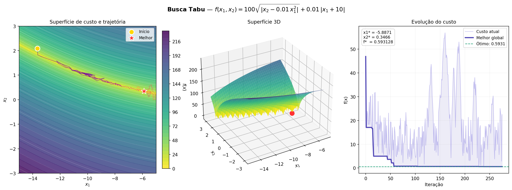
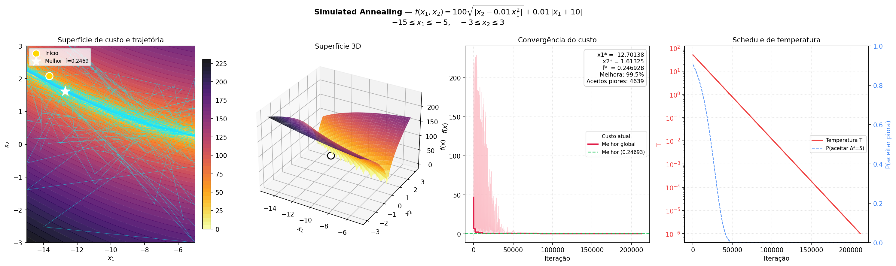
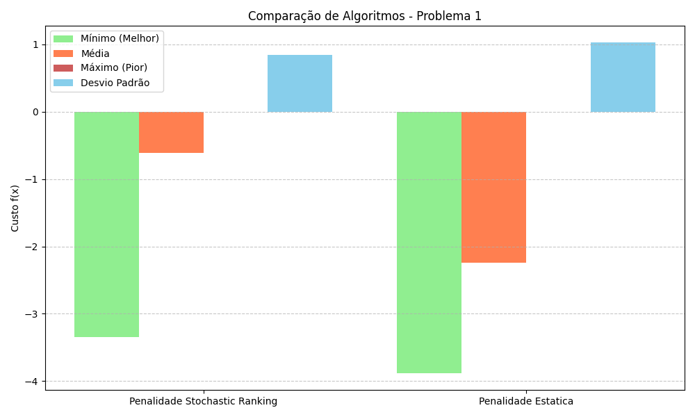
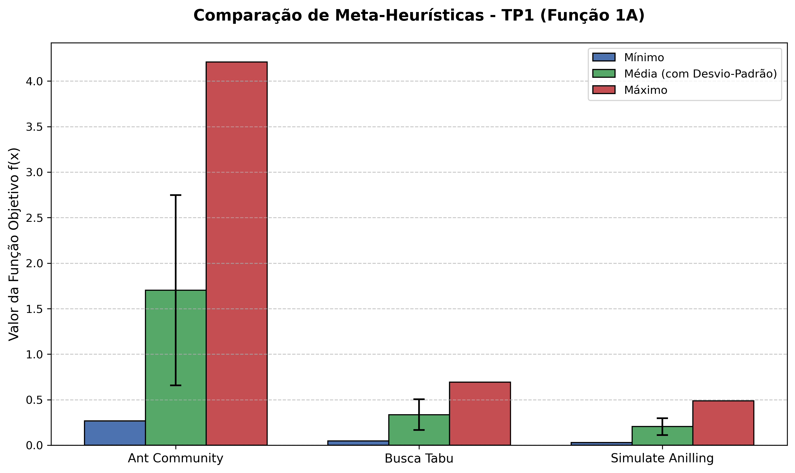
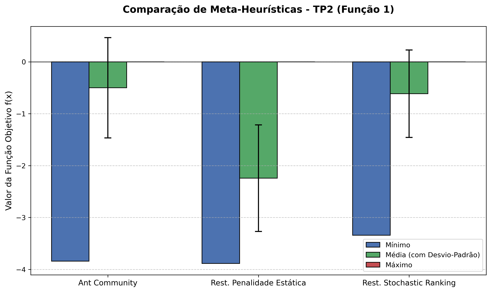

# Metaheuristic Optimization — Trabalhos Práticos

<div align="center">


**Estudo empírico comparativo de meta-heurísticas aplicadas a funções contínuas de benchmark e problemas de engenharia com restrições.**

</div>

---

## Visão Geral

Este repositório reúne os projetos práticos desenvolvidos na disciplina de **Otimização por Meta-heurísticas**, cobrindo desde métodos clássicos de busca local baseados em trajetória até algoritmos populacionais e inteligência de enxame. 

Todos os experimentos foram implementados em Python e submetidos a **30 execuções independentes** com sementes controladas para garantir rigor e significância estatística (análise de mínimo, média, desvio padrão e gráficos de boxplot).

---

## Índice dos Trabalhos Práticos

| Trabalho Prático | Paradigma | Algoritmos Implementados | Problemas Abordados | Diretório |
| :--- | :--- | :--- | :--- | :---: |
| **TP1** | **Trajetória (Busca Local)** | • Busca Tabu (*Tabu Search*)<br>• Recozimento Simulado (*Simulated Annealing*) | **1. Função de Bukin N. 6**<br>• Domínio A: $x_1 \in [-15, -5], x_2 \in [-3, 3]$<br>• Domínio B: $x_1 \in [-11, -9], x_2 \in [0, 2]$<br><br>**2. Função de Michalewicz ($d=2, m=10$)**<br>• Domínio A: $x_1, x_2 \in [0, \pi]$<br>• Domínio B: $x_1, x_2 \in [1.0, 2.5]$ | [`TP1/`](TP1/) |
| **TP2** | **Algoritmos Populacionais** | • Programação Evolutiva + Penalidade Estática (ER)<br>• Programação Evolutiva + Stochastic Ranking (SR) | • **Problema 1:** Otimização não linear quadrática com 4 variáveis e restrições de igualdade e desigualdade<br>• **Problema 2:** Projeto mecânico do **Redutor de Velocidade** (*Speed Reducer*, 7 variáveis e 11 restrições) | [`TP2/`](TP2/) |
| **TP3** | **Inteligência de Enxame** | • Otimização por Colônia de Formigas Contínua ($ACO_{\mathbb{R}}$) | • Aplicação na **Função de Bukin N. 6** (TP1 - Domínio A)<br>• Aplicação no **Problema 1 com Restrições** (TP2)<br>• **Consolidação comparativa geral** de todas as meta-heurísticas | [`TP3/`](TP3/) |

---

## Consolidação Geral dos Resultados

Abaixo são apresentados exemplos visuais do comportamento, trajetórias e comparações dos algoritmos implementados ao longo dos trabalhos práticos:

### 1. TP1 — Exemplos de Trajetória e Otimização Local (Função de Bukin N. 6)

#### Busca Tabu (*Tabu Search*)


#### Recozimento Simulado (*Simulated Annealing*)


---

### 2. TP2 — Comparativo de Métricas no Problema 1 (Restrições)
Métricas obtidas na Programação Evolutiva comparando **Penalidade Estática** e **Stochastic Ranking**:

<div align="center">



</div>

---

### 3. TP3 — Comparações de Desempenho entre Meta-heurísticas
Comparativos finais reunindo os resultados dos métodos de trajetória, evolutivos e de colônia de formigas ($ACO_{\mathbb{R}}$):

| Comparação no Benchmark TP1 (Bukin N. 6 - Domínio A) | Comparação no Problema 1 com Restrições (TP2) |
| :---: | :---: |
|  |  |

---

## Arquitetura do Repositório

O projeto segue uma estrutura modular, onde cada trabalho prático é autocontido (com seu próprio `README.md`, `Makefile`, `requirements.txt`, dados e relatório em PDF):

```text
Metaheuristic-Optimization/
│
├── Makefile                     # Orquestrador geral (comandos para rodar qualquer TP da raiz)
├── requirements.txt             # Dependências consolidadas de todo o projeto
├── README.md                    # Este portal de apresentação
├── .gitignore                   # Regras de ignorados (limpeza de caches e temporários)
│
├── TP1/                         # Busca Tabu & Simulated Annealing
│   ├── src/                     # Código fonte das meta-heurísticas
│   ├── data/                    # JSON com 30 runs e boxplots
│   ├── TP 1 - Meta-heuristica.pdf
│   ├── Makefile
│   ├── README.md
│   └── requirements.txt
│
├── TP2/                         # Programação Evolutiva (Penalidade Estática vs. SR)
│   ├── PE_*.py                  # Scripts de otimização dos Problemas 1 e 2
│   ├── geradorGraficos.py       # Script de geração dos boxplots e gráficos de barras
│   ├── Datas/                   # Boxplots, estatísticas JSON e gráficos de métricas
│   ├── TP 2 - Meta-heuristica.pdf
│   ├── Makefile
│   ├── README.md
│   └── requirements.txt
│
└── TP3/                         # Ant Colony Optimization Contínuo (ACOR)
    ├── Ant_System/              # Implementação do ACOR para domínios contínuos
    ├── main.py                  # Execução dos experimentos
    ├── comparacao.py            # Geração dos gráficos comparativos entre todos os TPs
    ├── Data/                    # Gráficos comparativos, boxplots e JSONs
    ├── TP 3 - Meta-heuristica.pdf
    ├── Makefile
    ├── README.md
    └── requirements.txt
```

---

## Como Executar

### Opção 1: Via Makefile Central (Recomendado)

Você pode instalar e executar qualquer trabalho prático diretamente da raiz do repositório:

```bash
# 1. Configurar os ambientes e dependências de todos os TPs:
make setup

# 2. Executar os experimentos de um trabalho específico:
make tp1   # Executa o TP1 (Busca Tabu e Simulated Annealing)
make tp2   # Executa o TP2 (Programação Evolutiva nos Problemas 1 e 2)
make tp3   # Executa o TP3 (ACO-R e comparativo geral)

# 3. Limpar caches temporários:
make clean
```

### Opção 2: Navegando para a pasta de cada TP

Cada pasta possui autonomia completa. Para executar um trabalho específico isoladamente:

```bash
cd TP1
make setup
make run
```

*(Consulte o `README.md` dentro de cada pasta para detalhes específicos dos algoritmos e hiperparâmetros).*

---

## Tecnologias Utilizadas

- **Linguagem:** [Python 3.10+](https://www.python.org/)
- **Computação Numérica:** [NumPy](https://numpy.org/), [SciPy](https://scipy.org/)
- **Visualização de Dados:** [Matplotlib](https://matplotlib.org/), [Seaborn](https://seaborn.pydata.org/)
- **Manipulação de Dados:** [Pandas](https://pandas.pydata.org/)
- **Automação de Build:** [GNU Make](https://www.gnu.org/software/make/)
