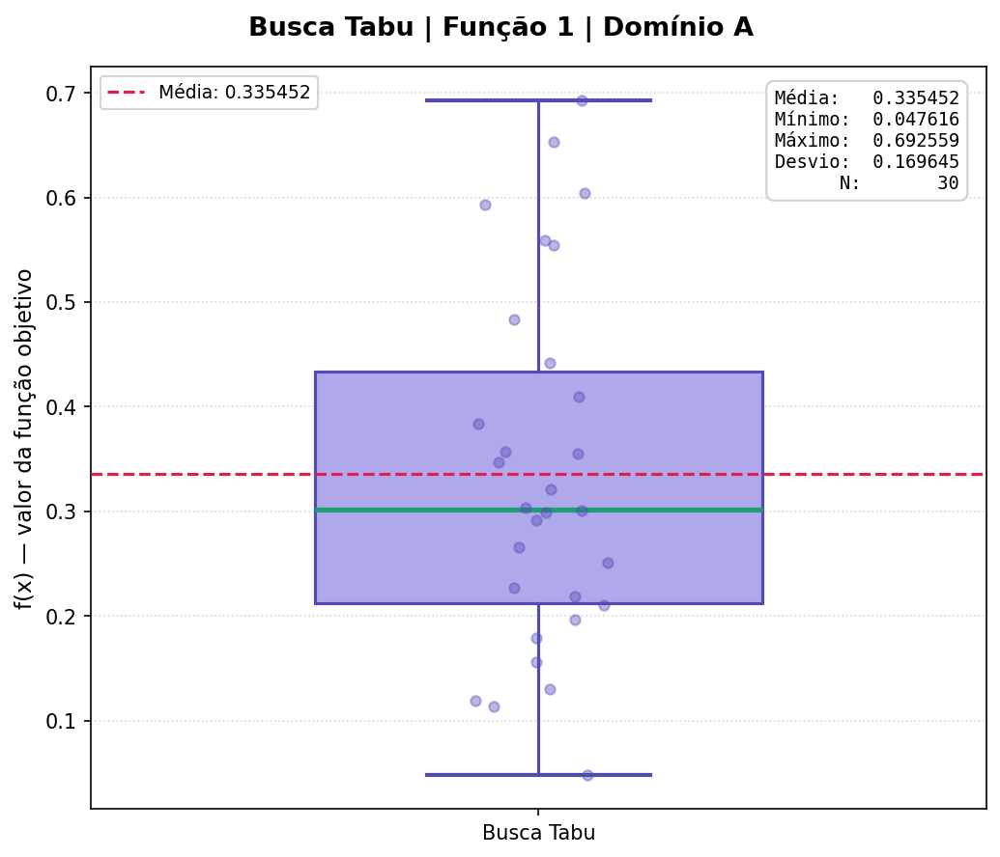
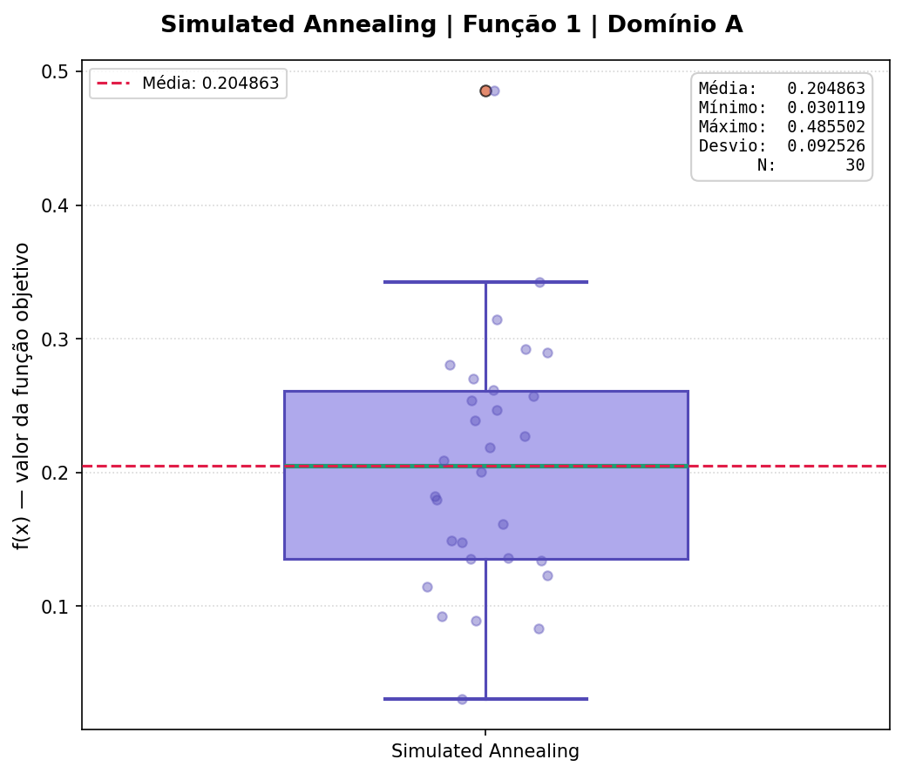
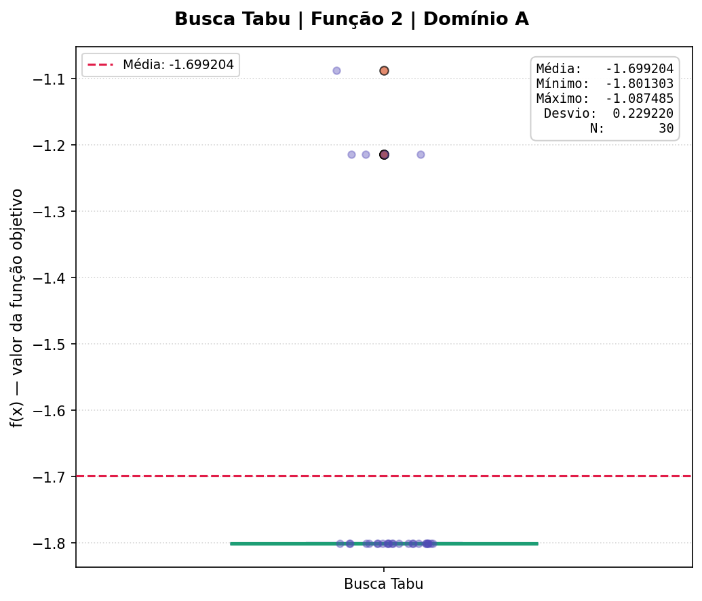
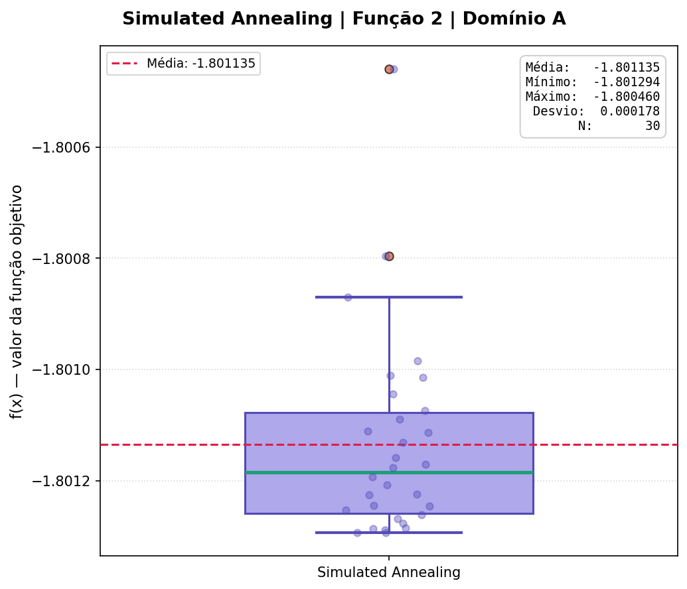

# Trabalho Prático 1: Meta-heurísticas de Trajetória
> **Busca Tabu (Tabu Search) e Recozimento Simulado (Simulated Annealing)**  
> Implementação e análise empírica comparativa em funções benchmark contínuas.

---

## Visão Geral

Este trabalho prático tem como objetivo a implementação, parametrização e avaliação experimental de duas das principais meta-heurísticas de trajetória (busca local baseada em solução única):
1. **Busca Tabu (Tabu Search - BT):** Utiliza estrutura de memória de curto prazo (lista tabu) para evitar ciclos e forçar a exploração de novas regiões do espaço de busca.
2. **Recozimento Simulado (Simulated Annealing - SA):** Inspirado no processo termodinâmico de recozimento de metais, aceita soluções de pior qualidade com probabilidade decrescente controlada pela temperatura para escapar de mínimos locais.

Ambos os algoritmos foram testados em **duas funções de benchmark multimodais** sob **dois domínios de busca distintos (A e B)**, executados ao longo de **30 rodadas independentes** para garantir significância estatística.

---

## Funções Benchmark e Domínios

### 1. Função de Bukin N. 6
$$f(x_1, x_2) = 100 \sqrt{|x_2 - 0.01 x_1^2|} + 0.01 |x_1 + 10|$$
- **Domínio A:** $x_1 \in [-15, -5], \quad x_2 \in [-3, 3]$
- **Domínio B:** $x_1 \in [-11, -9], \quad x_2 \in [0, 2]$
- **Mínimo Global Teórico:** $f(-10, 1) = 0$

### 2. Função de Michalewicz ($d=2, m=10$)
$$f(\mathbf{x}) = -\sum_{i=1}^{2} \sin(x_i) \cdot \sin^{20}\left(\frac{i \cdot x_i^2}{\pi}\right)$$
- **Domínio A:** $x_1, x_2 \in [0, \pi]$
- **Domínio B:** $x_1, x_2 \in [1.0, 2.5]$
- **Mínimo Global Teórico:** $f(\mathbf{x}) \approx -1.8013$ em $(2.2029, 1.5707)$

| Função | Domínio A | Domínio B | Mínimo Teórico |
| :--- | :--- | :--- | :---: |
| **Função de Bukin N. 6** | $x_1 \in [-15, -5], \; x_2 \in [-3, 3]$ | $x_1 \in [-11, -9], \; x_2 \in [0, 2]$ | $f(-10, 1) = 0$ |
| **Função de Michalewicz** | $x_1, x_2 \in [0, \pi]$ | $x_1, x_2 \in [1.0, 2.5]$ | $f(\mathbf{x}) \approx -1.8013$ |

---

## Resultados Experimentais (30 Execuções)

Os resultados consolidados das 30 execuções independentes para cada combinação de algoritmo, função e domínio:

| Função / Domínio | Meta-heurística | Mínimo (Melhor) | Média | Desvio Padrão |
| :--- | :--- | :---: | :---: | :---: |
| **Bukin N. 6 (Domínio A)** | Busca Tabu | 0.047616 | 0.335452 | 0.169645 |
| **Bukin N. 6 (Domínio A)** | Simulated Annealing | **0.030119** | **0.204863** | **0.092526** |
| **Bukin N. 6 (Domínio B)** | Busca Tabu | **0.025927** | 0.343457 | 0.165110 |
| **Bukin N. 6 (Domínio B)** | Simulated Annealing | 0.029142 | **0.191200** | **0.110085** |
| **Michalewicz (Domínio A)** | Busca Tabu | **-1.801303** | -1.699204 | 0.229220 |
| **Michalewicz (Domínio A)** | Simulated Annealing | -1.801294 | **-1.801135** | **0.000178** |
| **Michalewicz (Domínio B)** | Busca Tabu | **-1.801303** | **-1.801296** | **0.000010** |
| **Michalewicz (Domínio B)** | Simulated Annealing | -1.801302 | -1.801172 | 0.000151 |

> Dados detalhados salvos em [`data/resultados.json`](file:///home/gabriel/Área de Trabalho/Meta Heuristica/Metaheuristic-Otimization-/TP1/data/resultados.json) e relatório técnico completo em [`TP 1 - Meta-heuristica.pdf`](file:///home/gabriel/Área de Trabalho/Meta Heuristica/Metaheuristic-Otimization-/TP1/TP%201%20-%20Meta-heuristica.pdf).

---

## Boxplots de Convergência

Os boxplots mostram a distribuição dos melhores custos encontrados ao longo das 30 repetições:

| Busca Tabu | Simulated Annealing |
| :---: | :---: |
|  |  |
|  |  |

---

## Estrutura de Arquivos

```text
TP1/
├── Makefile                     # Atalhos de execução e automação
├── requirements.txt             # Dependências Python
├── README.md                    # Documentação do TP1
├── TP 1 - Meta-heuristica.pdf   # Relatório técnico do trabalho
├── src/
│   ├── main.py                  # Orquestrador dos 8 experimentos (30 runs cada)
│   ├── buscaTabu.py             # Busca Tabu (Função 1)
│   ├── buscaTabu2.py            # Busca Tabu (Função 2)
│   ├── simulateAnilling.py      # Simulated Annealing (Função 1)
│   └── simulateAnilling2.py     # Simulated Annealing (Função 2)
└── data/
    ├── resultados.json          # Resultados numéricos consolidados
    ├── resultados.pdf           # Relatório consolidado
    └── boxplots/                # Gráficos de distribuição e dispersão
```

---

## Como Executar

### Pré-requisitos
- Python 3.10+
- GNU Make (opcional, mas recomendado)

### 1. Usando Makefile (Recomendado)

```bash
# Configurar ambiente virtual e instalar dependências
make setup

# Executar a bateria completa de experimentos
make run

# Limpar arquivos de cache
make clean
```

### 2. Execução Manual

```bash
python3 -m venv .venv
source .venv/bin/activate
pip install -r requirements.txt

# Executar todos os testes
python src/main.py

# Ou executar um algoritmo individual
python src/buscaTabu.py
python src/simulateAnilling.py
```
