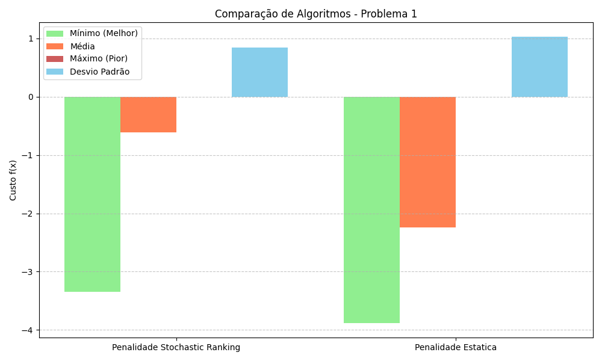
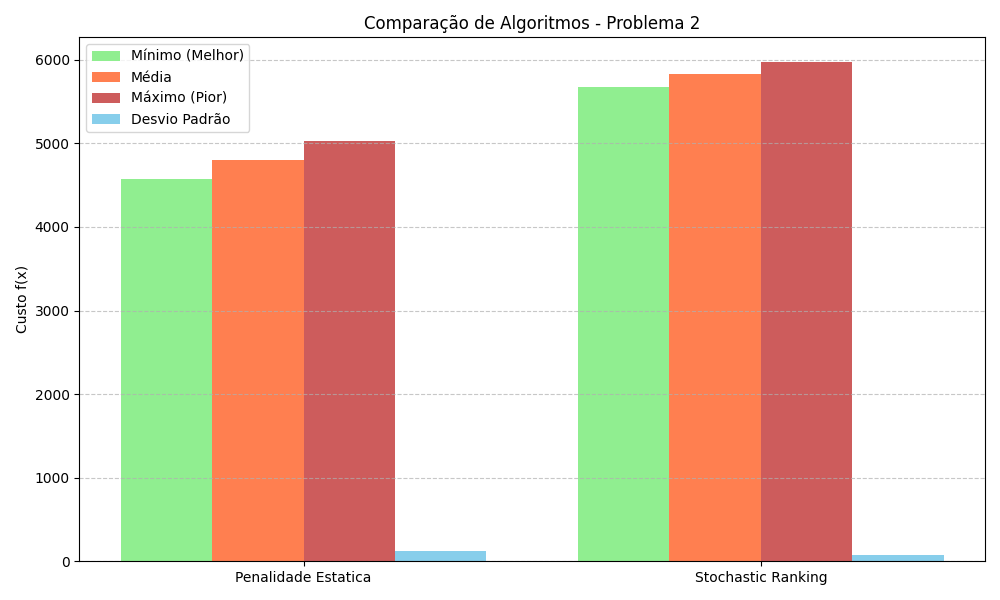
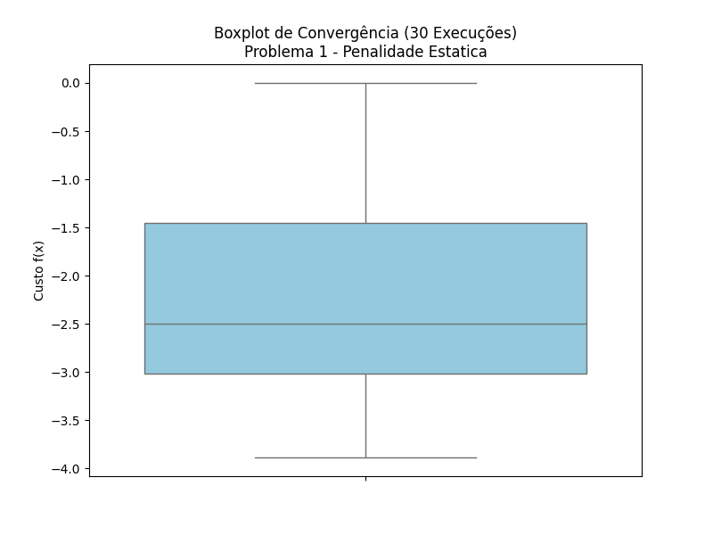
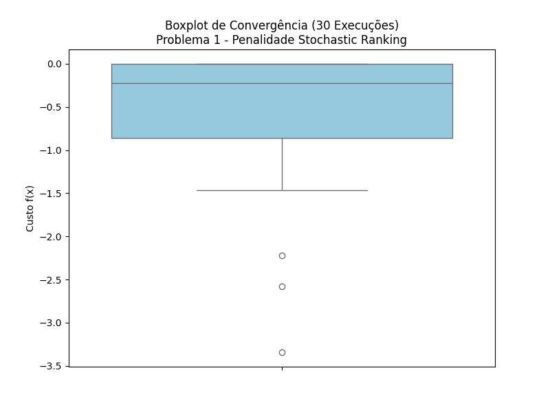
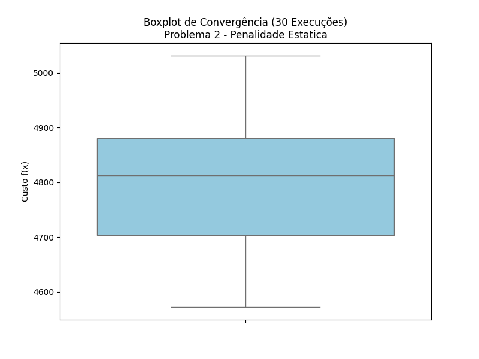
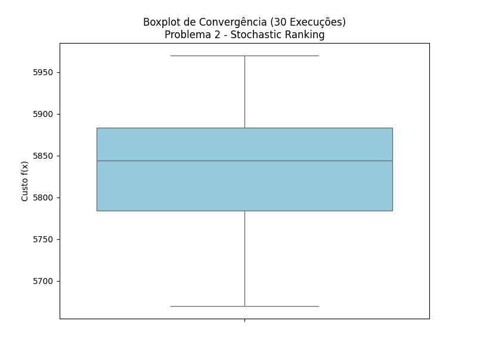

# Trabalho Prático 2: Otimização com Restrições via Programação Evolutiva
> **Programação Evolutiva (PE) com Penalidade Estática e Stochastic Ranking**  
> Tratamento de restrições em problemas de otimização contínua e projeto mecânico.

---

## Visão Geral

Este trabalho prático aborda a resolução de problemas de **otimização mono-objetivo com restrições** utilizando **Programação Evolutiva (Evolutionary Programming - PE)**, comparando duas abordagens clássicas para tratamento de restrições de igualdade e desigualdade:

1. **Penalidade Estática (Static Penalty - ER):** Aplica multas constantes proporcionais à magnitude da violação das restrições para desfavorecer soluções infactíveis na função fitness.
2. **Stochastic Ranking (SR):** Proposto por Runarsson & Yao, equilibra dinamicamente a função objetivo e a violação de restrições por meio de uma ordenação estocástica (usando um parâmetro de probabilidade $P_f$), permitindo explorar áreas infactíveis promissoras sem necessidade de ajuste de coeficientes de penalidade.

Ambas as abordagens foram avaliadas em **30 execuções independentes** em dois problemas desafiadores:
- **Problema 1:** Função não linear com 4 variáveis e restrições de igualdade e desigualdade.
- **Problema 2:** Projeto de Engenharia do **Redutor de Velocidade** (7 variáveis de projeto e 11 restrições não lineares de tensão, deflexão e geometria).

---

## Resultados Experimentais (30 Execuções)

| Problema | Método de Restrição | Mínimo (Melhor f(x)) | Média | Desvio Padrão |
| :--- | :--- | :---: | :---: | :---: |
| **Problema 1** | Penalidade Estática (ER) | **-3.887936** | **-2.242777** | 1.028224 |
| **Problema 1** | Stochastic Ranking (SR) | -3.343527 | -0.613888 | **0.841619** |
| **Problema 2 (Redutor)** | Penalidade Estática (ER) | **4572.335057** | **4803.132870** | 128.171221 |
| **Problema 2 (Redutor)** | Stochastic Ranking (SR) | 5669.899691 | 5828.488285 | **74.692557** |

> Dados detalhados em [`Datas/Estatisticas/`](file:///home/gabriel/Área de Trabalho/Meta Heuristica/Metaheuristic-Otimization-/TP2/Datas/Estatisticas) e relatório técnico completo em [`TP 2 - Meta-heuristica.pdf`](file:///home/gabriel/Área de Trabalho/Meta Heuristica/Metaheuristic-Otimization-/TP2/TP%202%20-%20Meta-heuristica.pdf).

---

## Visualizações e Análise Comparativa

### Comparativo de Métricas (Mínimo, Mediana, Média e Máximo)

| Problema 1 | Problema 2 (Redutor de Velocidade) |
| :---: | :---: |
|  |  |

### Boxplots de Dispersão

| Penalidade Estática | Stochastic Ranking |
| :---: | :---: |
|  |  |
|  |  |

---

## Estrutura de Arquivos

```text
TP2/
├── Makefile                     # Automação de execução
├── requirements.txt             # Dependências Python (numpy, matplotlib, seaborn)
├── README.md                    # Documentação do TP2
├── TP 2 - Meta-heuristica.pdf   # Relatório técnico do trabalho
├── PE_ER_Problem01.py           # Problema 1 com Penalidade Estática
├── PE_SR_Problem01.py           # Problema 1 com Stochastic Ranking
├── PE_ER_Problem02.py           # Problema 2 (Redutor) com Penalidade Estática
├── PE_SR_Problem02.py           # Problema 2 (Redutor) com Stochastic Ranking
├── geradorGraficos.py           # Script para consolidar JSONs e plotar gráficos
└── Datas/
    ├── Boxplots/                # Boxplots das 30 iterações de cada algoritmo
    ├── Estatisticas/            # JSONs com dados numéricos completos
    └── ViewEstatiticas/         # Gráficos de barras comparativas
```

---

## Como Executar

### 1. Usando Makefile (Recomendado)

```bash
# Configurar ambiente virtual e dependências
make setup

# Executar todos os 4 experimentos completos
make run

# Executar apenas o Problema 1 ou Problema 2
make run-p1
make run-p2

# Atualizar e regenerar os gráficos
make plots

# Limpar caches
make clean
```

### 2. Execução Manual

```bash
python3 -m venv .venv
source .venv/bin/activate
pip install -r requirements.txt

# Execuções individuais:
python PE_ER_Problem01.py
python PE_SR_Problem01.py
python PE_ER_Problem02.py
python PE_SR_Problem02.py

# Gerar gráficos:
python geradorGraficos.py
```
