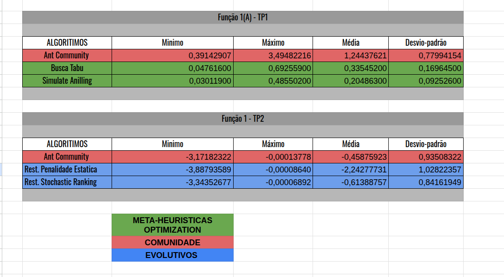
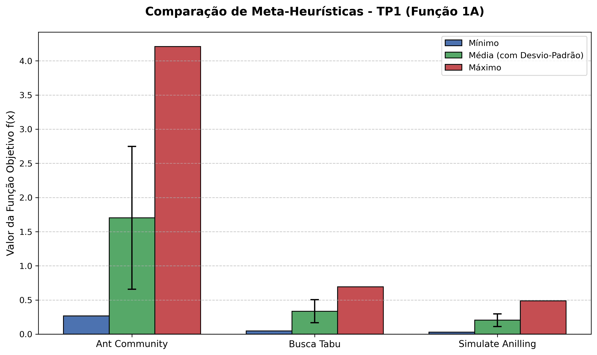
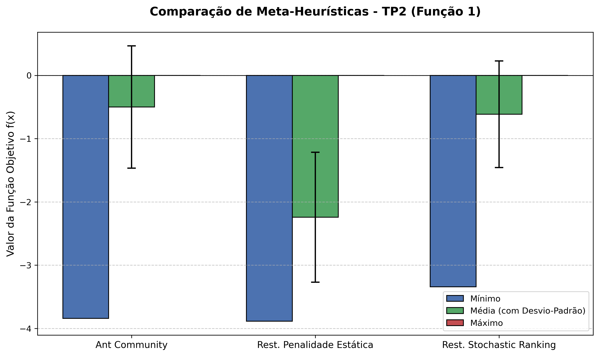
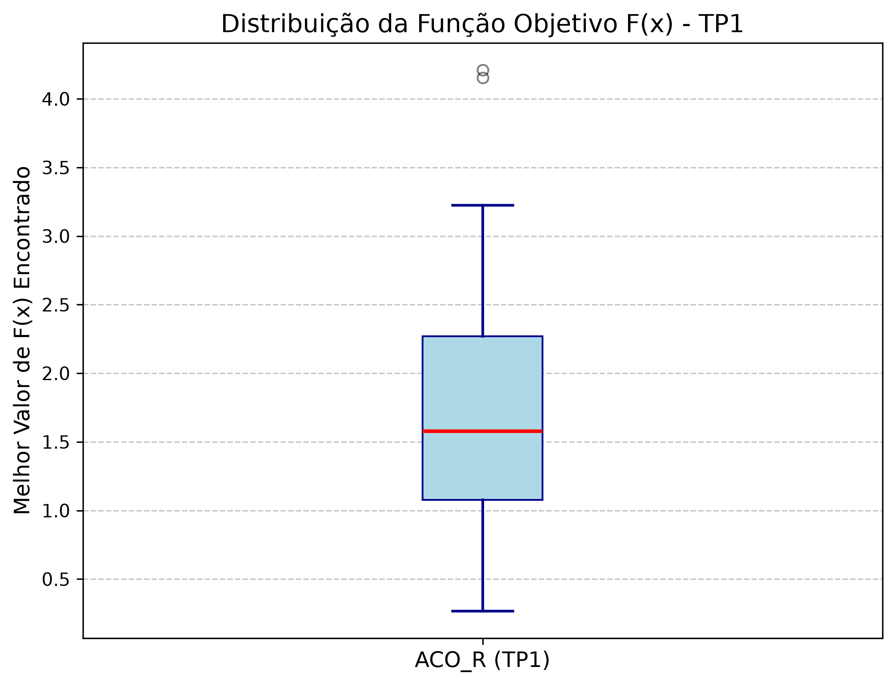
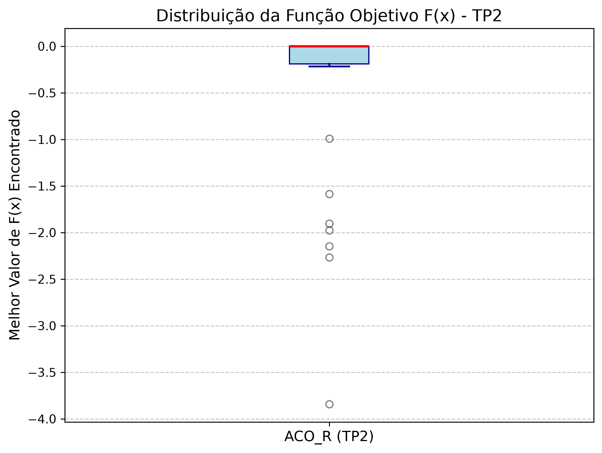

# Trabalho Prático 3: Ant Colony Optimization Contínuo ($ACO_{\mathbb{R}}$)
> **Otimização por Colônia de Formigas para Domínios Contínuos e Comparativo Geral**  
> Aplicação do $ACO_{\mathbb{R}}$ e consolidação das meta-heurísticas de todos os trabalhos práticos.

---

## Visão Geral

O **Trabalho Prático 3** implementa a extensão contínua do algoritmo clássico de Colônia de Formigas, denominada **$ACO_{\mathbb{R}}$ (Ant Colony Optimization for Continuous Domains)**. Diferente do ACO discreto baseado em grafos, o $ACO_{\mathbb{R}}$ opera amostrando novas soluções a partir de uma função de densidade de probabilidade baseada em um **Kernel Gaussiano Multimodal** ponderado pelo histórico das melhores soluções arquivadas.

Neste trabalho, o $ACO_{\mathbb{R}}$ foi aplicado em dois cenários para permitir a comparação direta com os trabalhos anteriores:
1. **Problema Benchmark do TP1 (Função 1 - Domínio A):** Comparado contra Busca Tabu (BT) e Recozimento Simulado (Simulated Annealing - SA).
2. **Problema com Restrições do TP2 (Problema 1):** Comparado contra Programação Evolutiva com Penalidade Estática (PE-ER) e Stochastic Ranking (PE-SR).

---

## Tabela Comparativa Consolidada

Abaixo está o comparativo geral consolidando o desempenho de todas as meta-heurísticas estudadas na disciplina ao longo de 30 execuções independentes:



### Resumo Numérico das Meta-heurísticas

| Problema / Benchmark | Algoritmo | Mínimo (Melhor) | Média | Desvio Padrão |
| :--- | :--- | :---: | :---: | :---: |
| **TP1 (Função 1A)** | Ant Community ($ACO_{\mathbb{R}}$) | 0.266878 | 1.702202 | 1.045811 |
| **TP1 (Função 1A)** | Busca Tabu | 0.047616 | 0.335452 | 0.169645 |
| **TP1 (Função 1A)** | Simulated Annealing | **0.030119** | **0.204863** | **0.092526** |
| **TP2 (Problema 1)** | Ant Community ($ACO_{\mathbb{R}}$) | -3.841732 | -0.501078 | 0.967092 |
| **TP2 (Problema 1)** | PE - Penalidade Estática | **-3.887936** | **-2.242777** | 1.028224 |
| **TP2 (Problema 1)** | PE - Stochastic Ranking | -3.343527 | -0.613888 | **0.841619** |

---

## Gráficos Comparativos

### Comparação de Desempenho entre Meta-heurísticas

| Benchmark TP1 (Função 1A) | Problema com Restrições TP2 (Problema 1) |
| :---: | :---: |
|  |  |

### Boxplots de Dispersão do $ACO_{\mathbb{R}}$

| $ACO_{\mathbb{R}}$ no Benchmark TP1 | $ACO_{\mathbb{R}}$ no Problema TP2 |
| :---: | :---: |
|  |  |

---

## Estrutura de Arquivos

```text
TP3/
├── Makefile                     # Automação de execução (make run, make compare)
├── requirements.txt             # Dependências Python (numpy, matplotlib)
├── README.md                    # Documentação do TP3
├── TP 3 - Meta-heuristica.pdf   # Relatório técnico do trabalho
├── main.py                      # Orquestrador dos experimentos de ACO-R
├── comparacao.py                # Script que gera os gráficos comparativos finais
├── Ant_System/
│   ├── ant_system_continuos_TP1.py  # ACO-R para Função 1 (TP1)
│   └── ant_system_continuos_TP2.py  # ACO-R para Problema 1 com Restrições (TP2)
└── Data/
    ├── Tabela_Comparativa.png   # Tabela visual comparativa
    ├── comparacao_*.png         # Gráficos de barras comparando todos os métodos
    ├── boxplot_resultados_*.png # Boxplots de dispersão
    └── resultados_aco_r_*.json  # Dados numéricos das 30 rodadas
```

---

## Como Executar

### 1. Usando Makefile (Recomendado)

```bash
# Configurar ambiente virtual e dependências
make setup

# Executar as 30 rodadas de ACO-R nos dois problemas
make run

# Gerar os gráficos comparativos com as meta-heurísticas anteriores
make compare

# Limpar caches
make clean
```

### 2. Execução Manual

```bash
python3 -m venv .venv
source .venv/bin/activate
pip install -r requirements.txt

# Executar os experimentos
python main.py

# Gerar gráficos comparativos
python comparacao.py
```
